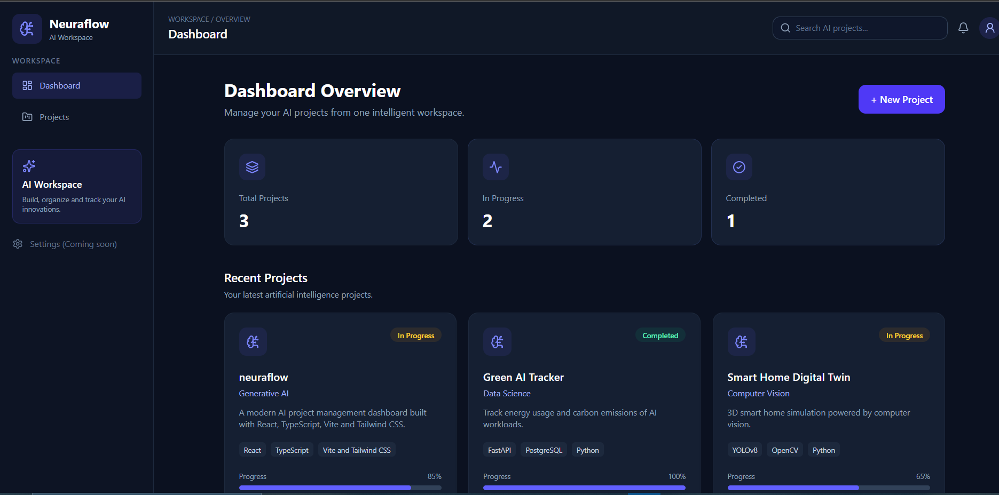
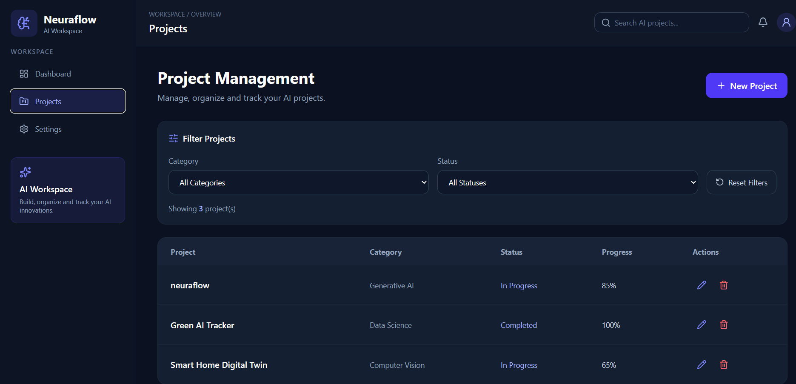
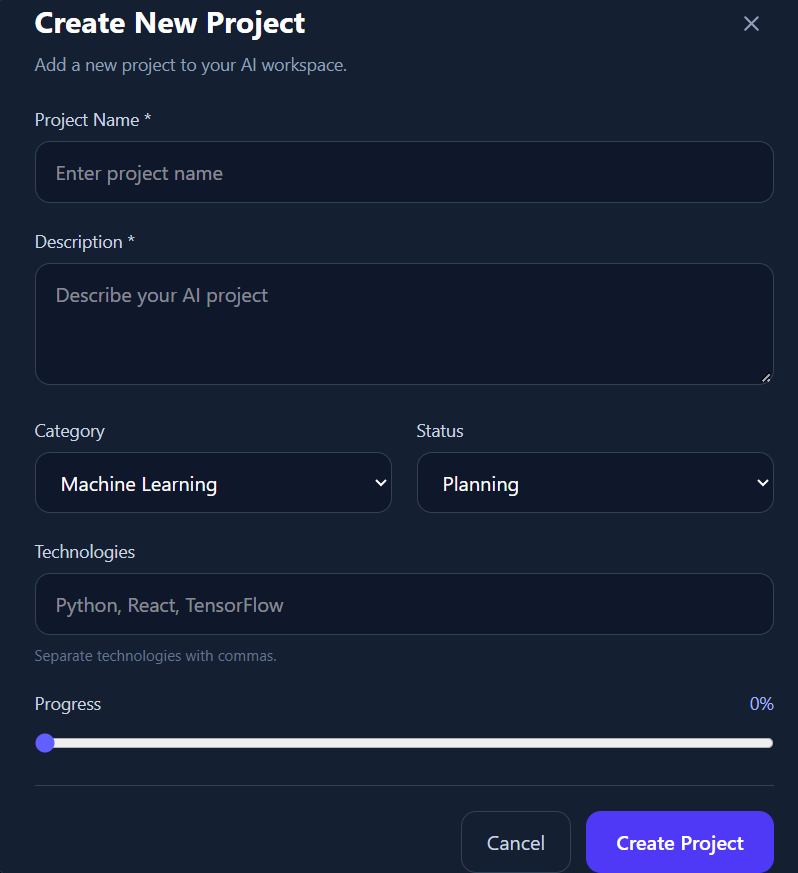
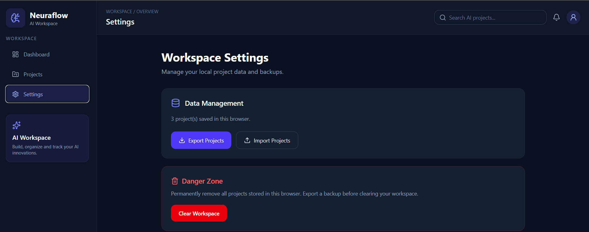

# 🧠 Neuraflow

## AI Project Intelligence Workspace

Neuraflow is a modern, responsive web application designed to help users organize, manage, and track their artificial intelligence projects in one centralized workspace.

Built with **React, TypeScript, Vite, and Tailwind CSS**, Neuraflow provides an intuitive dashboard, complete project management functionality, real-time search, and persistent browser-based data storage.

## ✨ Features

- **Interactive Dashboard:** Track total, ongoing, and completed projects.
- **Full CRUD Operations:** Create, view, update, and delete AI projects.
- **Project Organization:** Categorize projects by AI discipline and development status.
- **Real-Time Search:** Find projects by name, description, category, status, or technology.
- **Advanced Filtering:** Filter projects by category and status.
- **Progress Tracking:** Monitor individual project completion percentages.
- **Persistent Storage:** Save project data locally using the browser's LocalStorage API.
- **Deletion Confirmation:** Prevent accidental deletion through a custom confirmation dialog.
- **Responsive Design:** Use the application across desktop, tablet, and mobile screens.
- **Type-Safe Architecture:** Maintain structured project models using TypeScript interfaces.
- **JSON Backup Management:** Export and import project data using JSON files.
- **Workspace Data Management:** Clear locally stored projects with confirmation.

## 🛠️ Technology Stack

| Technology | Purpose |
| --- | --- |
| React | Component-based frontend development |
| TypeScript | Static typing and maintainability |
| Vite | Development server and production build |
| Tailwind CSS | Responsive interface styling |
| Lucide React | Interface iconography |
| LocalStorage API | Browser-based data persistence |
| Git & GitHub | Version control and source code hosting |

## 📸 Screenshots

### Dashboard



### Project Management



### Create Project



### Workspace Settings

Manage local project data, export JSON backups, import saved projects, and clear workspace data.



## 🚀 Getting Started

### Prerequisites

Install Node.js and npm.

### Installation

Clone the repository:

```bash
git clone https://github.com/Merdgn/neuraflow.git
```

Navigate into the project directory:

```bash
cd neuraflow
```

Install dependencies:

```bash
npm install
```

Start the development server:

```bash
npm run dev
```

Open the local URL displayed in your terminal, typically `http://localhost:5173/`.

### Production Build

```bash
npm run build
```

The compiled production files will be generated in the `dist` directory.

## 📂 Project Structure

```text
src/
├── components/     # Reusable UI components
├── pages/          # Dashboard and project management pages
├── interfaces/     # TypeScript models and interfaces
├── hooks/          # Project state and CRUD operations
├── utils/          # Utility functions
├── data/           # Example project data
├── App.tsx         # Main application component
└── main.tsx        # Application entry point
```

## 💾 Data Storage

Neuraflow uses the browser's LocalStorage API to save project information without requiring a backend server.

Data persists across page reloads within the same browser storage context.

**Note:** This version does not provide user authentication, cloud synchronization, or a live AI model integration. Clearing browser storage may permanently remove saved project data.

## 🔮 Future Improvements

- Cloud database integration
- User authentication and personalized workspaces
- Project analytics and visual reporting
- AI-powered project recommendations
- Import and export functionality
- Improved accessibility and automated testing

## 🌐 Live Demo

Deployment link will be added after publishing the application.

## 👩‍💻 Development

Developed as a modern web development project demonstrating React architecture, TypeScript, responsive frontend design, CRUD operations, browser-based persistence, and Git-based version control.

## 📄 License

No open-source license has been assigned to this repository.
